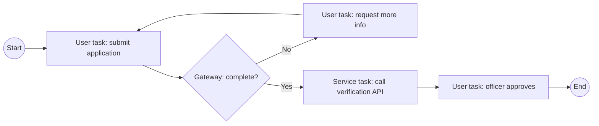
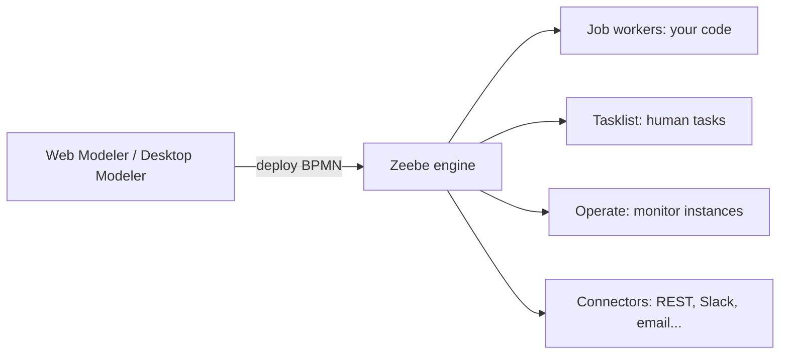

Workflow engines run **business processes** (approvals, cases, onboarding, orders) from a diagram or definition, keeping state, waiting for people and calling services. This is process orchestration, a cousin of container orchestration ([[Orchestration Platforms]]). Camunda use cases are in [[Common Camunda Use Cases]].

## Tools at a glance

| Tool | Type | Notes |
| ---- | ---- | ----- |
| **Camunda 8** | BPMN engine (Zeebe) + tools | Modeler, Operate, Tasklist, Optimize, Connectors; SaaS or self-managed |
| **SpiffWorkflow / SpiffArena** | Python BPMN engine and low-code platform | Citizen-developer friendly, open source |
| **n8n** | Visual automation (nodes and triggers) | Great for integrations and webhooks |
| **Temporal** | Code-first durable workflows | Workflows written as code, strong retries |
| **Apache Airflow / Prefect** | Data pipeline schedulers | Jobs and DAGs rather than human processes |
| **AWS Step Functions** | Managed state machines | See [[6. AWS Developer Services and Serverless]] |
| **Azure Logic Apps / Durable Functions** | Managed workflows | See [[7. Azure Application Development]] |
| **Django Viewflow** | Workflow library for Django | Used in the Django tests |

---

# BPMN in a Nutshell

**BPMN 2.0** (Business Process Model and Notation) is a standard diagram language that is also **executable**.

| Element | Meaning |
| ------- | ------- |
| **Event** (circle) | Start, end, timer, message, error |
| **Task** (rounded box) | User task (a person), service task (code or API), script, business rule |
| **Gateway** (diamond) | Decision (exclusive), parallel split / join, event-based |
| **Sequence flow** | Order of steps |
| **Pool / lane** | Participants or roles |
| **Subprocess** | A process inside a process |
| **Boundary event** | Timer or error attached to a task (e.g. escalate after 3 days) |

Process **variables** carry data; **DMN** tables hold decision rules readable by business users; **FEEL** is the expression language in Camunda 8.

---

# Camunda 8

- **Zeebe** is the cloud-native engine; it schedules work and **job workers** (your services) poll for jobs, do the work and complete them
- **Operate** shows running and failed process instances; **Tasklist** is the inbox for human tasks
- **Connectors** call REST APIs and SaaS without writing a worker
- Try it with the Camunda 8 Code Studio ([[Camunda 8 Code Studio Tutorial]])

---

# SpiffWorkflow and SpiffArena

- **SpiffWorkflow** is the Python library that executes BPMN
- **SpiffArena** is the platform around it: a BPMN.js web editor, process groups, forms, message correlation, service connectors and monitoring
- Runs from Docker or locally (Python with `uv`, MySQL / PostgreSQL / SQLite for development)
- Aimed at **citizen developers**: flow-chart and spreadsheet-style tools to capture rules that everyone can read and execute

# n8n

- **Triggers** (webhook, schedule, app event) start a workflow of **nodes** (HTTP request, database, email, code)
- Self-host with `npm install -g n8n` or Docker, UI on port 5678
- Has a **REST API**, so another app (e.g. Django) can create and trigger workflows programmatically
- Good for integration glue and automations; for long-lived human processes with audit and versioning, a BPMN engine fits better

---

# Choosing

| Need | Good fit |
| ---- | -------- |
| Long-running, human-heavy business processes with diagrams the business can read | **BPMN engine** (Camunda, Spiff) |
| Quick integrations between SaaS apps and webhooks | **n8n** |
| Workflows defined in application code with strong reliability | **Temporal**, Durable Functions, Step Functions |
| Data pipelines on a schedule | **Airflow / Prefect** |
| Workflows inside a Django app | **Viewflow** or a BPMN engine called over its API |

## Case-management example
A case moves through submit → triage → investigate → decide → close. Django stores the case and permissions; the engine (n8n or BPMN) owns the **process state**, timers (SLAs) and notifications. Keep one source of truth for status and let the other react to events.

Related: [[AI Agents and Workflows]] (agent pipelines are workflows with human gates too), [[2. Docker Compose]] (engines usually run beside a database in Compose).
