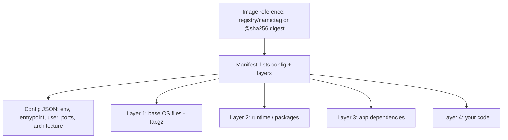
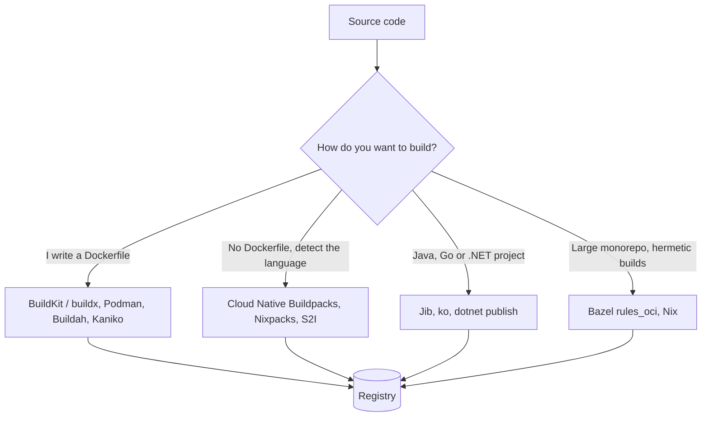
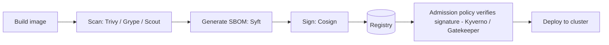

What an image actually is, where images are stored, and the range of tools that can build them. Docker basics are in [[1. Docker]]; what runs the images is in [[Orchestration Platforms]].

## Tools at a glance

| Category | Tools |
| -------- | ----- |
| **Dockerfile builders** | Docker BuildKit / `buildx`, Podman, Buildah, Kaniko, img |
| **No-Dockerfile builders** | Cloud Native Buildpacks (`pack`), Paketo, Nixpacks, Source-to-Image (S2I) |
| **Language-native** | Jib (Java), `ko` (Go), .NET SDK container publish, Spring Boot `bootBuildImage` |
| **Build systems** | Bazel `rules_oci`, Nix `dockerTools`, Earthly |
| **Registries** | Docker Hub, GHCR, Quay, AWS ECR, Azure ACR, Google Artifact Registry, Harbor, GitLab Registry |
| **Cloud build services** | AWS CodeBuild, Azure ACR Tasks, Google Cloud Build, GitHub Actions |
| **Security** | Trivy, Grype, Docker Scout, Snyk, Cosign, Syft (SBOM) |

---

# Anatomy of an Image

An **OCI image** is made of:



- **Layers** are content-addressed tarballs of filesystem changes, identified by a **SHA-256 digest**; identical layers are stored and downloaded once and shared between images
- **Manifest** points to the config and layers; an **image index** (manifest list) points to one manifest per platform (`linux/amd64`, `linux/arm64`), which is how one tag works on both Intel and ARM
- **Config** holds runtime defaults (`ENV`, `CMD`, `ENTRYPOINT`, `USER`, `EXPOSE`)
- At run time a container adds a thin **writable layer** on top via a union filesystem (overlayfs)

```
$ docker history shop-api:1.0                # layers and sizes
$ docker inspect shop-api:1.0                # config + layer digests
$ docker manifest inspect nginx:1.27         # multi-platform index
$ docker save shop-api:1.0 -o shop-api.tar   # export as a tarball
$ docker load -i shop-api.tar
```

## Each Part Explained

One running example for every part: a small Python web app built from this Dockerfile.

```dockerfile
# base image layers
FROM python:3.12-slim
WORKDIR /app
COPY requirements.txt .
# dependencies layer
RUN pip install -r requirements.txt
# your code layer
COPY . .
ENV PORT=8000
USER 1000
EXPOSE 8000
CMD ["python", "app.py"]
```

### 1. Image reference: the address
Tells Docker **where** to fetch the image and **which version**.

```
ghcr.io / sharif / shop-api : 1.0
registry   owner     name     tag
```

- No registry shown (`nginx:1.27`) means Docker Hub
- Think of it as a street address: it points to the image but is not the image
- A `@sha256:...` digest instead of a tag points at exactly one build forever (see below)

### 2. Manifest: the table of contents
A small JSON file listing the config and every layer by digest and size. Docker reads this first, then downloads only the layers it does not already have.

Simplified, with `//` comments added for explanation (real JSON has none):

```json
{
  "schemaVersion": 2,
  "mediaType": "application/vnd.oci.image.manifest.v1+json",
  "config": { "digest": "sha256:9a1b...", "size": 1450 },
  "layers": [
    { "digest": "sha256:aa11...", "size": 29100000 },   // base OS
    { "digest": "sha256:bb22...", "size": 41800000 },   // Python runtime
    { "digest": "sha256:cc33...", "size": 12400000 },   // pip dependencies
    { "digest": "sha256:dd44...", "size": 18000 }       // your code
  ]
}
```

- Like a recipe card: "to make this image, stack these four layers in this order"
- See it with `docker manifest inspect python:3.12-slim`
- For multi-platform images, an **image index** sits above it and points to one manifest per CPU type (`amd64`, `arm64`), so one tag works on a laptop and a Raspberry Pi

### 3. Config: the settings
A JSON file describing how to **run** the image, not what is inside it.

```json
{
  "architecture": "amd64",
  "os": "linux",
  "config": {
    "Env": ["PORT=8000", "PATH=/usr/local/bin:..."],
    "Cmd": ["python", "app.py"],
    "User": "1000",
    "WorkingDir": "/app",
    "ExposedPorts": { "8000/tcp": {} }
  },
  "rootfs": { "type": "layers", "diff_ids": ["sha256:...", "sha256:..."] }
}
```

- Every `ENV`, `CMD`, `ENTRYPOINT`, `USER`, `WORKDIR` and `EXPOSE` line from the Dockerfile ends up here, not in a layer
- This is why you can override the command with `docker run image other-command` without rebuilding
- Also holds build **history** and the list of layer ids

### 4. Layer 1: base OS files
The bottom layer comes from `FROM`. It holds a minimal operating system: `/bin`, `/lib`, `/etc`, package tools.

```
/bin/bash  /lib/x86_64-linux-gnu/  /etc/os-release  /usr/bin/apt ...
```

- Roughly 30-120 MB for Debian or Ubuntu, 5 MB for Alpine, near zero for distroless or `scratch`
- Shared by every image built on the same base, so it is downloaded once and reused
- Does **not** include a kernel: containers borrow the host's

### 5. Layer 2: runtime and language tools
Added by the base image's own Dockerfile (the `python:3.12-slim` part, or via your own `RUN apt-get install`).

```
/usr/local/bin/python3.12
/usr/local/lib/python3.12/
```

- Contains the interpreter or runtime: Python, Node.js, a JRE
- Changes rarely, so it caches well

### 6. Layer 3: dependencies
Created by `RUN pip install -r requirements.txt` (or `npm ci`, `mvn dependency:resolve`).

```
/usr/local/lib/python3.12/site-packages/flask/
/usr/local/lib/python3.12/site-packages/requests/
```

- Files that **changed** during the `RUN` become the layer, so only the installed packages are stored
- Placed **before** your code on purpose: dependencies change less often than code, so Docker can reuse this layer when only your code changes
- Biggest cache win in most Dockerfiles

### 7. Layer 4: your application code
Created by `COPY . .`

```
/app/app.py
/app/templates/index.html
/app/static/style.css
```

- Smallest and fastest-changing layer, so it sits on top
- Edit one line of code and only this layer is rebuilt and pushed (a few KB), not the other 80 MB

### 8. The writable layer (at runtime only)
When you `docker run`, Docker adds a thin **read-write** layer on top of the read-only image layers.

```
Container writable layer   ← logs, temp files, anything the app writes
Layer 4  your code         ┐
Layer 3  dependencies      │ read-only, shared by every
Layer 2  Python runtime    │ container from this image
Layer 1  base OS           ┘
```

- Delete the container and this layer disappears; use a volume for data you want to keep ([[1. Docker]])
- Many containers can run from one image and share all the read-only layers

### How a Dockerfile maps to parts

| Dockerfile line | Becomes | In a layer? |
| --------------- | ------- | ----------- |
| `FROM python:3.12-slim` | Layers 1 and 2 (base) | Yes |
| `WORKDIR /app` | Config `WorkingDir` (creates the directory) | Metadata |
| `COPY requirements.txt .` | Small file layer | Yes |
| `RUN pip install ...` | Layer 3 | Yes |
| `COPY . .` | Layer 4 | Yes |
| `ENV PORT=8000` | Config `Env` | Metadata |
| `USER 1000` | Config `User` | Metadata |
| `EXPOSE 8000` | Config `ExposedPorts` | Metadata |
| `CMD [...]` | Config `Cmd` | Metadata |

Only `FROM`, `COPY`, `ADD` and `RUN` add filesystem layers; the rest only edit the config.

### See it yourself

```
$ docker history shop-api:1.0
IMAGE         CREATED BY                              SIZE
dd44...       COPY . . # buildkit                     18kB
cc33...       RUN pip install -r requirements.txt     12.4MB
bb22...       COPY requirements.txt . # buildkit      45B
<base>        python:3.12-slim layers                 ~120MB

$ docker save shop-api:1.0 -o shop.tar && mkdir x && tar -xf shop.tar -C x
$ ls x/blobs/sha256            # each file is a layer tarball, the config, or the manifest
$ docker inspect --format '{{json .RootFS.Layers}}' shop-api:1.0
```

Why it matters:
- **Fast pulls and pushes**: only new layers move
- **Cache**: order Dockerfile lines from least to most changing
- **Size**: a file deleted in a later layer still exists in the earlier one; clean up in the **same** `RUN`, or use a multi-stage build
- **Security**: a secret copied into any layer stays in the image history

## Naming: tags vs digests

```
registry.example.com/team/shop-api:1.4.2
registry.example.com/team/shop-api@sha256:3f1c...   # immutable
```

- A **tag** is a movable label; `:latest` is just a tag, not "newest"
- A **digest** is immutable and identifies exact content. Pin digests (or immutable tags) for reproducible production deploys
- Recommended tags: the **git commit SHA** and a **semantic version**; avoid reusing a tag

## Base image choices

| Base | Size | Notes |
| ---- | ---- | ----- |
| `ubuntu` / `debian` | 30-120 MB | Familiar, `apt`, glibc |
| `-slim` variants | Smaller | Debian without extras |
| **Alpine** | ~5 MB | **musl libc**, can break some binaries / Python wheels |
| **Distroless** | 2-20 MB | No shell or package manager, smaller attack surface |
| **Chainguard / Wolfi** | Small | Minimal, frequently patched |
| **`scratch`** | 0 | Empty; for static binaries (Go, Rust) |
| Red Hat **UBI** | Medium | Supported base for OpenShift / enterprise |

---

# Registries

Where images are stored and pulled from.

| Registry | Notes |
| -------- | ----- |
| **Docker Hub** | Default, public images, pull rate limits |
| **GHCR** (`ghcr.io`) | GitHub Packages, tied to repos and Actions |
| **Quay** (`quay.io`) | Red Hat; scanning built in |
| **Amazon ECR** | Private / public, IAM auth, scanning, replication ([[3. AWS Compute]]) |
| **Azure Container Registry** | Geo-replication, ACR Tasks, Entra auth ([[2. Azure Compute]]) |
| **Google Artifact Registry** | Docker, Maven, npm etc. in one place |
| **Harbor** | Open-source, self-hosted, RBAC, replication, scanning |
| **GitLab / Gitea / Nexus / Artifactory** | Often combined with CI |

```
$ docker login ghcr.io
$ docker tag shop-api:1.0 ghcr.io/sharif/shop-api:1.0
$ docker push ghcr.io/sharif/shop-api:1.0

# ECR example
$ aws ecr get-login-password | docker login --username AWS --password-stdin 123456789012.dkr.ecr.af-south-1.amazonaws.com

# ACR example
$ az acr login --name myregistry123
```

Run a local registry for testing: `docker run -d -p 5000:5000 registry:2`.

Kubernetes pulls private images using an `imagePullSecret` or cloud identity ([[4. Running Your Containers in Kubernetes]]).

---

# Build Tools



## Docker BuildKit and buildx
The default Docker builder. Parallel stages, better caching, secrets and SSH mounts, multi-platform output.

```
$ docker build -t shop-api:1.0 .
$ docker buildx create --use --name multi
$ docker buildx build --platform linux/amd64,linux/arm64 -t ghcr.io/sharif/shop-api:1.0 --push .
$ docker buildx build --secret id=npmrc,src=$HOME/.npmrc .     # build secret never stored in a layer
$ docker buildx build --cache-from type=registry,ref=ghcr.io/sharif/cache \
                      --cache-to type=registry,ref=ghcr.io/sharif/cache,mode=max .
```

In the Dockerfile, a build secret and cache mount:

```dockerfile
# syntax=docker/dockerfile:1
RUN --mount=type=secret,id=npmrc,target=/root/.npmrc \
    --mount=type=cache,target=/root/.npm \
    npm ci
```

## Podman and Buildah (daemonless, rootless)
Red Hat tools, no central daemon, runs as a normal user. `podman` is a drop-in CLI replacement (`alias docker=podman`); `buildah` builds images with or without a Dockerfile.

```
$ podman build -t shop-api:1.0 .
$ podman run --rm -p 8080:80 shop-api:1.0
$ podman generate kube shop-api > pod.yaml         # export a running container as Kubernetes YAML
$ podman play kube pod.yaml
$ buildah bud -t shop-api:1.0 .
```

## Kaniko (build inside Kubernetes / CI)
Builds from a Dockerfile **without a Docker daemon and without privileged mode**, ideal in CI pods and Tekton. (Google archived the original repo in 2025; maintained forks exist, evaluate before adopting.)

```
$ /kaniko/executor --context=dir:///workspace --dockerfile=Dockerfile \
    --destination=myregistry/shop-api:1.0
```

## Cloud Native Buildpacks (CNB), `pack`, Paketo
Turn source into an image **with no Dockerfile**: detect language, pick a build, add a runtime, produce reproducible layers with an SBOM. Used by Heroku, Google Cloud, Spring Boot, Cloud Foundry.

```
$ pack build shop-api:1.0 --builder paketobuildpacks/builder-jammy-base
$ pack inspect shop-api:1.0
```

## Nixpacks, Source-to-Image (S2I)
- **Nixpacks** (used by Railway) detects the app and generates an image
- **S2I** (OpenShift) injects source into a builder image: `s2i build . ubi8/python-39 shop-api`

## Language-native builders

| Tool | Language | Idea |
| ---- | -------- | ---- |
| **Jib** | Java (Maven / Gradle) | Layers dependencies and classes separately, no Docker daemon, fast rebuilds |
| **`ko`** | Go | `ko build ./cmd/app` builds a distroless image directly |
| **.NET SDK** | C# | `dotnet publish -t:PublishContainer` |
| **Spring Boot** | Java | `./mvnw spring-boot:build-image` (uses Buildpacks) |

```
$ mvn compile jib:build -Dimage=ghcr.io/sharif/shop-api:1.0
$ KO_DOCKER_REPO=ghcr.io/sharif ko build ./cmd/app
```

## Bazel, Nix, Earthly
- **Bazel `rules_oci`**: deterministic, cacheable builds for large monorepos
- **Nix `dockerTools`**: bit-for-bit reproducible minimal images
- **Earthly**: Dockerfile-like syntax with Makefile-style targets, runs identically in CI and locally

## Cloud build services

| Service | Example |
| ------- | ------- |
| **Azure ACR Tasks** | `az acr build -r myregistry123 -t shop-api:1.0 .` |
| **AWS CodeBuild** | `buildspec.yml` with `docker build` / `docker push` ([[AWS CodePipeline]]) |
| **Google Cloud Build** | `gcloud builds submit --tag gcr.io/PROJECT/shop-api` |
| **GitHub Actions** | `docker/build-push-action` ([[GitHub Actions]]) |

---

# Comparison

| Tool | Needs daemon | Rootless | Dockerfile needed | Best for |
| ---- | ------------ | -------- | ----------------- | -------- |
| **BuildKit / buildx** | Yes (or built-in) | Optional | Yes | General use, multi-arch, caching |
| **Podman / Buildah** | No | Yes | Optional | RHEL / Fedora, security-conscious |
| **Kaniko** | No | In-container | Yes | Building inside Kubernetes CI |
| **Buildpacks** | Needs a builder | Yes | No | Standardised builds across many apps |
| **Jib / ko** | No | Yes | No | JVM or Go teams wanting fast layered builds |
| **Bazel / Nix** | No | Yes | No | Reproducible monorepos |

---

# Optimising Images

1. Order Dockerfile steps from rarely to often changing for cache hits ([[1. Docker]])
2. **Multi-stage** builds: compile in one stage, copy artifacts into a tiny runtime stage
3. Use **small, pinned** base images and a `.dockerignore`
4. Combine `RUN` steps and clean package caches in the same layer
5. Do not bake secrets, `.git`, test data or build tools into the final image
6. Inspect bloat with `docker history` or the **`dive`** tool
7. Build **multi-platform** if you run on ARM nodes (AWS Graviton, Apple Silicon, Raspberry Pi)

---

# Supply Chain Security



- **Vulnerability scanning**: `trivy image shop-api:1.0`, registry scanners (ECR, ACR, Harbor, Quay)
- **SBOM** (software bill of materials): `syft shop-api:1.0 -o spdx-json`
- **Signing and verification**: **Cosign** (Sigstore), Notary; enforce in the cluster with **Kyverno**, **OPA Gatekeeper** or the cloud's policy engine
- **Provenance** attestations (SLSA) from the build system
- Rebuild regularly to pick up base image fixes; use **digests** and an automated updater (Renovate, Dependabot)
- Run as non-root, read-only root filesystem, drop capabilities

---

# Image Lifecycle in a Pipeline

1. Commit triggers CI ([[CI-CD Pipelines]])
2. Build image (BuildKit / Kaniko / Buildpacks), tag with the commit SHA
3. Scan and sign
4. Push to a registry
5. Deployment references the immutable tag or digest
6. A **retention policy** cleans old images (ECR lifecycle rules, ACR purge tasks)
