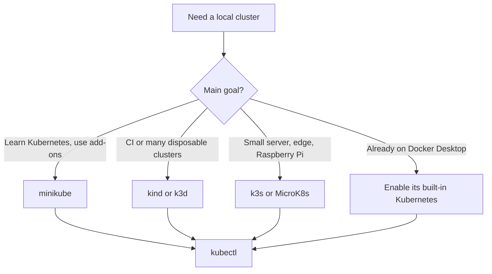
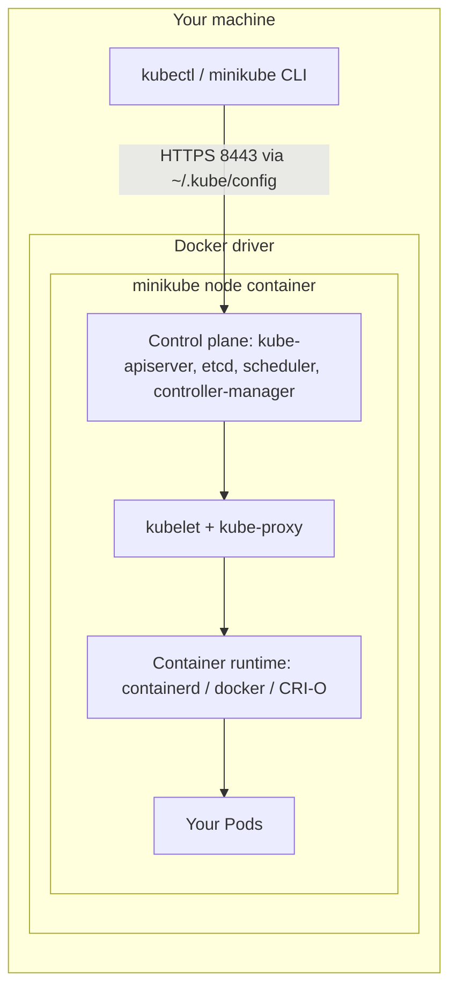
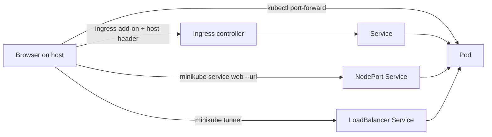
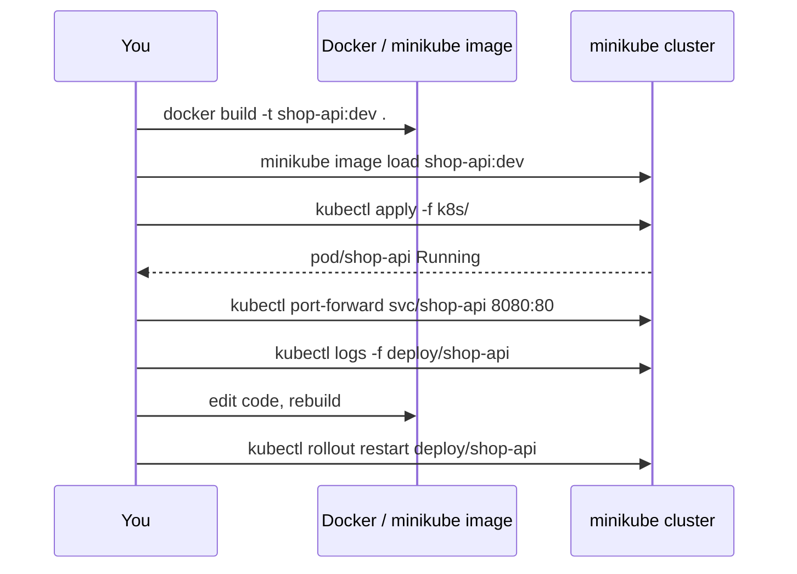

> **Repositories:** study notes and manifests in [sharifndlovu123/k8s-playground](https://github.com/sharifndlovu123/k8s-playground) (minikube, kind, kubectl, sample app, production-grade clusters) · course companion [sharifndlovu123/devops-directive-kubernetes-course](https://github.com/sharifndlovu123/devops-directive-kubernetes-course)

Extras to go with the chapters: a working guide to running Kubernetes on your own machine. The first install walk-through is in [[3. Installing Your First Kubernetes Cluster]]. Commands you will use daily are in [[kubectl Cheat Sheet]].

## Tools at a glance

| Tool | What it is | Good for |
| ---- | ---------- | -------- |
| **minikube** | Local single or multi-node cluster in a Docker container or VM | Learning, add-ons, closest to "a real cluster on a laptop" |
| **kind** | Nodes as Docker containers | CI pipelines, multi-node, testing Kubernetes itself |
| **k3s** | Lightweight certified Kubernetes in one binary | Edge, Raspberry Pi, small servers |
| **k3d** | Runs k3s clusters inside Docker | Fast throwaway clusters with a built-in registry |
| **MicroK8s** | Canonical's snap-based Kubernetes | Ubuntu, simple add-on system |
| **Docker Desktop** | Single-node cluster toggle | Convenience on Windows / macOS |
| **Rancher Desktop** | Desktop app with k3s | Free Docker Desktop alternative |
| **kubectl** | The client for all of them | Everything ([[2. Kubernetes Architecture – from Container Images to Running Pods]]) |
| **Helm** | Package manager for Kubernetes | Installing charts (nginx, Prometheus...) |
| **k9s / Lens / Headlamp** | Terminal and desktop UIs | Browsing and debugging clusters |
| **kubectx / kubens** | Switch context and namespace fast | Multi-cluster work |
| **Skaffold / Tilt** | Dev loop automation | Rebuild and redeploy on code change |



---

# minikube in Depth

minikube creates a cluster inside a **driver**. With the Docker driver the whole node is one container on your machine.



## Install and start

```
$ curl -LO https://storage.googleapis.com/minikube/releases/latest/minikube-linux-amd64
$ sudo install minikube-linux-amd64 /usr/local/bin/minikube
$ minikube start --driver=docker
$ minikube status
$ kubectl get nodes
```

Choose resources and version:

```
$ minikube start --cpus=4 --memory=4096 --disk-size=30g --kubernetes-version=v1.30.0
$ minikube config set driver docker          # make it the default
$ minikube config set cpus 4
```

## Drivers

| Driver | Notes |
| ------ | ----- |
| `docker` | Default on Linux, fastest startup, shares host kernel |
| `podman` | Rootless alternative |
| `kvm2` | Real VM on Linux, strongest isolation |
| `virtualbox`, `vmware`, `hyperkit`, `hyperv` | VM drivers for other platforms |
| `none` | Runs directly on the host (needs root, avoid on a daily machine) |

## Profiles (several clusters side by side)

Each profile is its own cluster and its own `kubectl` context.

```
$ minikube start -p dev
$ minikube start -p test --nodes 3
$ minikube profile list
$ minikube profile dev               # set the default profile
$ minikube delete -p test
$ minikube delete --all
```

Stop vs pause vs delete:

| Command | Effect |
| ------- | ------ |
| `minikube stop` | Stops the node, keeps all state, frees CPU / RAM |
| `minikube pause` | Freezes Kubernetes components, node keeps running |
| `minikube delete` | Removes the cluster and all data |

## Add-ons

Optional cluster features switched on with one command.

```
$ minikube addons list
$ minikube addons enable ingress
$ minikube addons enable metrics-server
$ minikube addons enable dashboard
$ minikube addons enable registry
```

| Add-on | Gives you |
| ------ | --------- |
| `ingress` | An NGINX **Ingress controller** for HTTP routing |
| `metrics-server` | Enables `kubectl top pods/nodes` and autoscaling |
| `dashboard` | Web UI (`minikube dashboard`) |
| `registry` | In-cluster image registry |
| `storage-provisioner` | Default **StorageClass** for PersistentVolumeClaims (on by default) |
| `csi-hostpath-driver`, `volumesnapshots` | CSI storage and snapshots |

## Reaching your apps from the host

A Pod IP lives inside the node and is not reachable from your laptop directly. Options:



```
$ kubectl expose deployment web --type=NodePort --port=80
$ minikube service web --url                  # prints a reachable URL
$ minikube service web                        # opens it in the browser

$ kubectl expose deployment web --type=LoadBalancer --port=80
$ minikube tunnel                             # run in another terminal; assigns an external IP

$ kubectl port-forward svc/web 8080:80        # simplest for quick tests
$ minikube ip                                 # the node's IP
```

`minikube tunnel` needs to keep running and may ask for sudo to create routes.

## Using local images (no registry)

Three ways to get an image you just built into the cluster:

```
# 1. Point your Docker CLI at minikube's Docker daemon, then build
$ eval $(minikube docker-env)
$ docker build -t shop-api:dev .
$ eval $(minikube docker-env -u)              # undo

# 2. Load an image you already built on the host
$ minikube image load shop-api:dev
$ minikube image ls

# 3. Build inside minikube
$ minikube image build -t shop-api:dev .
```

Then in the manifest set `imagePullPolicy: IfNotPresent` (or `Never`) so Kubernetes does not try to pull it from a registry:

```yaml
containers:
  - name: api
    image: shop-api:dev
    imagePullPolicy: IfNotPresent
```

Gotcha: a tag of `latest` defaults to `imagePullPolicy: Always`, which fails for local-only images.

## Sharing files with the node

```
$ minikube mount ~/projects/site:/site        # keep running; host dir appears at /site in the node
$ minikube ssh                                # shell into the node
$ minikube cp local.txt minikube:/tmp/local.txt
```

`hostPath` volumes refer to the **node's** filesystem, so mount first if you want host files.

## Multi-node and version testing

```
$ minikube start --nodes 3 -p multi
$ kubectl get nodes
$ minikube start -p old --kubernetes-version=v1.28.0
```

Useful for testing scheduling, anti-affinity, taints / tolerations and rolling upgrades.

## Troubleshooting

| Symptom | Try |
| ------- | --- |
| `minikube start` hangs or errors | `minikube delete` then start again; check `docker ps`, free disk and RAM |
| `Exiting due to PROVIDER_DOCKER_NOT_RUNNING` | Start the Docker daemon and make sure your user is in the `docker` group |
| `kubectl` talks to the wrong cluster | `kubectl config get-contexts`, `kubectl config use-context minikube` |
| Pod stuck `ErrImagePull` / `ImagePullBackOff` on a local image | Use `minikube image load` and `imagePullPolicy: IfNotPresent` |
| `LoadBalancer` EXTERNAL-IP shows `<pending>` | Run `minikube tunnel` |
| Ingress returns 404 / no address | Enable the `ingress` add-on, wait for its Pod in `ingress-nginx`, check `kubectl get ingress` |
| Cluster is slow | Raise `--cpus` / `--memory`, delete unused profiles |
| Need logs | `minikube logs`, `minikube logs --problems` |
| Clean slate | `minikube delete --all --purge` |

---

# kind (Kubernetes IN Docker)

Each node is a Docker container running a full kubelet, so creating and destroying clusters takes seconds. Built for testing Kubernetes and for CI.

```
$ kind create cluster --name demo
$ kind get clusters
$ kind load docker-image shop-api:dev --name demo     # push a local image into every node
$ kind delete cluster --name demo
```

Multi-node with port mappings so the host can reach an Ingress:

```yaml
# kind-config.yaml
kind: Cluster
apiVersion: kind.x-k8s.io/v1alpha4
nodes:
  - role: control-plane
    extraPortMappings:
      - containerPort: 80
        hostPort: 8080
      - containerPort: 443
        hostPort: 8443
  - role: worker
  - role: worker
```

```
$ kind create cluster --config kind-config.yaml
```

Differences from minikube: no add-on system and no built-in dashboard, but real multi-node and very fast; context name is `kind-<name>`.

---

# k3s and k3d

**k3s** is a single binary (<100 MB) that bundles a lightweight Kubernetes: SQLite instead of etcd by default, containerd, Traefik ingress, ServiceLB, CoreDNS. Ideal for Raspberry Pi and edge.

```
$ curl -sfL https://get.k3s.io | sh -
$ sudo k3s kubectl get nodes
$ sudo cat /etc/rancher/k3s/k3s.yaml          # kubeconfig, copy to ~/.kube/config
# join an agent node:
$ curl -sfL https://get.k3s.io | K3S_URL=https://<server>:6443 K3S_TOKEN=<token> sh -
```

**k3d** wraps k3s in Docker:

```
$ k3d cluster create dev --servers 1 --agents 2 -p "8080:80@loadbalancer"
$ k3d cluster list
$ k3d cluster delete dev
```

---

# MicroK8s, Docker Desktop and Rancher Desktop

```
$ sudo snap install microk8s --classic
$ microk8s status --wait-ready
$ microk8s enable dns ingress storage
$ microk8s kubectl get nodes
```

- **Docker Desktop**: Settings → Kubernetes → Enable. One node, context `docker-desktop`; version is tied to the Docker Desktop release
- **Rancher Desktop**: choose the Kubernetes version and container engine (`containerd` or `dockerd`), ships `kubectl` and `helm`

---

# Comparison

| | minikube | kind | k3s / k3d | MicroK8s | Docker Desktop |
| - | -------- | ---- | --------- | -------- | -------------- |
| Start time | ~30-60 s | ~20-30 s | ~10 s | ~30 s | Part of app startup |
| Multi-node | Yes | Yes | Yes | Yes | No |
| Built-in add-ons | Many | No | Some (Traefik, ServiceLB) | Many | No |
| Dashboard | Yes | No | No | Yes | No |
| Local image workflow | `image load` / `docker-env` | `kind load` | `k3d image import` | Built-in registry | Shares Docker images directly |
| Best at | Learning | CI / testing | Lightweight, edge | Ubuntu | Convenience |

---

# Managing Contexts and Many Clusters

`kubectl` reads `~/.kube/config`, which can hold local clusters and cloud ones (GKE, EKS, AKS) side by side. See contexts in [[3. Installing Your First Kubernetes Cluster]].

```
$ kubectl config get-contexts
$ kubectl config use-context minikube
$ kubectl config current-context
$ kubectl config set-context --current --namespace=dev
```

Safer habits:
- Show the context in your shell prompt
- Install `kubectx` and `kubens` to switch fast: `kubectx minikube`, `kubens dev`
- Double check the context before `delete` or `apply` against a **cloud** cluster
- Use separate kubeconfig files with `KUBECONFIG=~/.kube/dev:~/.kube/prod kubectl config view --flatten`

---

# Helm

A package manager: a **chart** is a bundle of templated manifests, a **release** is an installed instance, a **repository** hosts charts.

```
$ curl https://raw.githubusercontent.com/helm/helm/main/scripts/get-helm-3 | bash
$ helm repo add bitnami https://charts.bitnami.com/bitnami
$ helm repo update
$ helm search repo nginx
$ helm install web bitnami/nginx --set service.type=NodePort
$ helm list
$ helm upgrade web bitnami/nginx --set replicaCount=3
$ helm rollback web 1
$ helm uninstall web
$ helm template web bitnami/nginx > rendered.yaml     # see the YAML without installing
```

Override defaults with a values file:

```yaml
# values.yaml
replicaCount: 2
service:
  type: NodePort
```

```
$ helm install web bitnami/nginx -f values.yaml
```

**Kustomize** (built into `kubectl -k`) is the template-free alternative: a `kustomization.yaml` patches base manifests per environment.

```
$ kubectl apply -k overlays/dev
```

---

# Handy UIs and Dev-loop Tools

| Tool | Notes |
| ---- | ----- |
| **k9s** | Terminal UI: `:pods`, `:deploy`, `l` logs, `s` shell, `d` describe, `/` filter |
| **Lens** | Desktop IDE for clusters |
| **Headlamp** | Extensible web / desktop UI |
| **Kubernetes Dashboard** | Official web UI (`minikube dashboard`) |
| **stern** | Tail logs from many Pods at once: `stern web -n dev` |
| **kubectl-neat, kubectl-tree** | Plugins for tidy output and object ownership trees, install with **krew** |
| **Skaffold / Tilt** | Rebuild image, redeploy, and port-forward whenever code changes |
| **Telepresence** | Run one service locally while it talks to the cluster |

Plugin manager:

```
$ kubectl krew install ctx ns neat tree
```

---

# A Typical Local Workflow



1. Build the image ([[1. Docker]])
2. Load it into the cluster
3. Apply manifests ([[4. Running Your Containers in Kubernetes]])
4. Reach the app (port-forward, NodePort + `minikube service`, or Ingress)
5. Inspect, change, repeat
6. `minikube stop` when done, `minikube delete` to reset

Compose users can compare against [[2. Docker Compose]]; managed cloud equivalents are AKS ([[2. Azure Compute]]) and EKS ([[3. AWS Compute]]).
